# tde-mixer

A per-application volume mixer for the [Trinity Desktop Environment](https://www.trinitydesktop.org/)
that works with **PipeWire** and **PulseAudio**. It replaces KMix in the
system tray and works like the mixers of other current desktops.

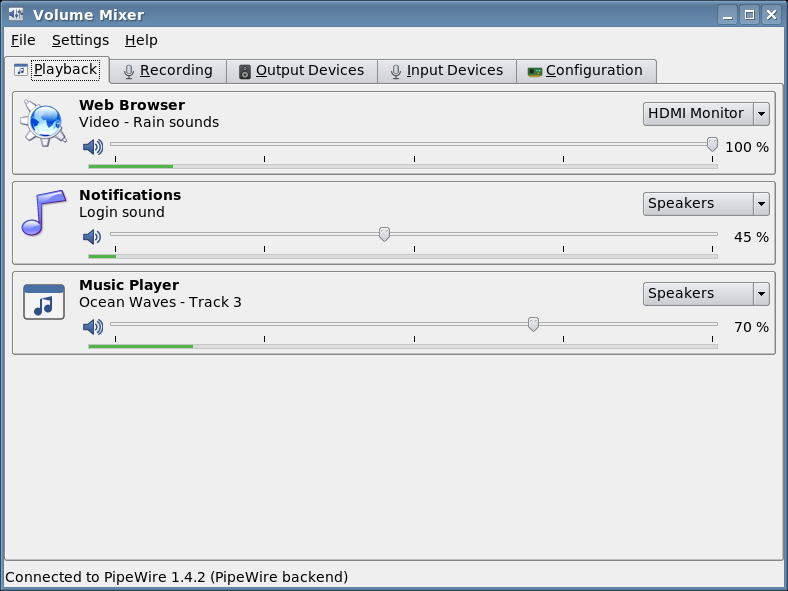

KMix controls the channels of the sound card (Master, PCM, ...). On current
systems sound goes through a sound server instead, which gives every
application its own volume and can send each one to a different device.
tde-mixer controls the sound server.

## Features

* **Per-application volume**: one slider, mute button and level meter for
  each application playing or recording sound, plus a list to move it to
  another output or input device while it plays
* **Devices**: volume, mute, port (speakers / headphones, ...) and the
  default device, for outputs and inputs
* **Sound cards**: choose the profile (analog stereo, HDMI, surround,
  Bluetooth headset modes, off)
* **System tray icon** (`tde-mixer-tray`), starts at login: the default
  output's volume in the icon and tooltip, left click for a popup with the
  master and per-application volumes, middle click to mute, mouse wheel to
  change the volume, output device menu
* **Volume keys** (XF86AudioRaiseVolume / LowerVolume / Mute / MicMute),
  configurable
* **Trinity Control Center module**: *Sound & Multimedia → Volume Mixer*
  (`tdecmshell mixer`), with a Settings tab
* **System Settings** (`tde-systemsettings`): *Computer Administration →
  Volume Mixer*
* **Two backends**: native PipeWire (libpipewire, like `wpctl`) and
  PulseAudio (libpulse, also works with `pipewire-pulse`); *Automatic* picks
  PipeWire if it runs. Reconnects when the sound server restarts.
* **Replaces KMix without removing it**: on first start the tray asks once
  whether KMix's autostart should be turned off
* Volumes above 100 % (optional), configurable volume step
* Command line: `tde-mixer --list`, `--volume 40`, `--toggle-mute`
* A handbook in KHelpCenter and man pages `tde-mixer(1)`, `tde-mixer-tray(1)`

| | |
|---|---|
| 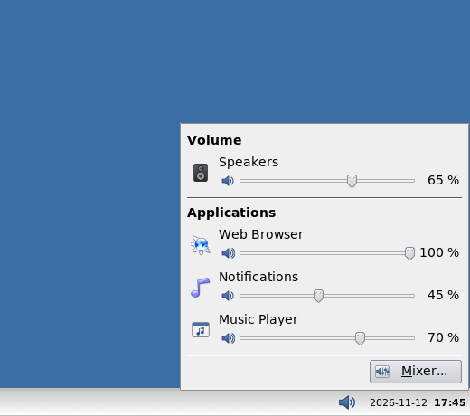 | 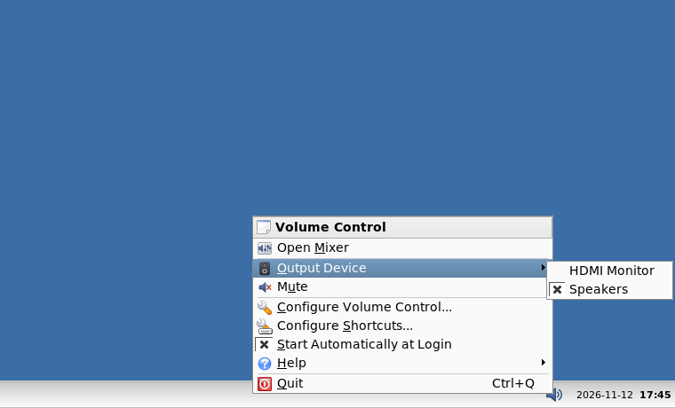 |

## Installing

Pre-built packages for **Debian 12 (bookworm)** and **Debian 13 (trixie)**
are in the [Yjlion TDE apt repository](https://github.com/Yjlion/tde-apt):

```sh
sudo apt install tde-mixer-trinity
```

They are also attached to the
[Releases](https://github.com/Yjlion/tde-mixer/releases) and to the
artifacts of the *Build Debian packages* workflow:

```sh
sudo apt install ./tde-mixer-trinity_*.deb
```

The package needs `pipewire-pulse` (with WirePlumber) or `pulseaudio`, and
TDE from the [TDE repository](https://wiki.trinitydesktop.org/Debian_Trinity_Repository_Installation_Instructions).
It can be installed next to `kmix-trinity`.

## Usage

* The tray icon starts at the next login (or run `tde-mixer-tray`). If
  KMix starts at login too, it offers to turn KMix off.
* The mixer: *TDE menu → Multimedia → Volume Mixer*, the tray icon's
  *Open Mixer*, or `tde-mixer [--page playback|recording|output|input|configuration]`.
* Settings: the *Settings* tab of the Control Center module, or
  *Settings → Configure Volume Mixer* in the mixer.

```
$ tde-mixer --list
Backend: PipeWire, server: PipeWire 1.4.2
Output devices:
    42         HDMI Monitor [hdmi]
               volume: 80 % (FL 80 %, FR 80 %)
  * 48         Speakers [speakers]
               volume: 65 % (FL 65 %, FR 65 %)
...
```

## Building

Build dependencies (Debian names): `tde-cmake`, `tdelibs14-trinity-dev`,
`libtqt3-mt-dev`, `libtqtinterface-dev`, `libpipewire-0.3-dev`,
`libpulse-dev`.

```sh
mkdir build && cd build
cmake .. -DCMAKE_INSTALL_PREFIX=/opt/trinity
make && sudo make install
```

Options: `-DWITH_PIPEWIRE=OFF` or `-DWITH_PULSE=OFF` leave out a backend,
`-DBUILD_DOC=OFF` the handbook, `-DBUILD_TESTS=ON` builds the backend test
program. To build the Debian package: `dpkg-buildpackage -us -uc -b`.

### Tests

`tests/run-backend-tests.sh` starts a sound server with virtual devices and
test streams (`tools/audio-test-env.sh`), then checks stream and device
volume, mute, moving a stream, the default device, the level meters and
reconnecting after a server restart against `pactl`:

```sh
tests/run-backend-tests.sh build/tests/backendtest pipewire pipewire  # native backend
tests/run-backend-tests.sh build/tests/backendtest pulse pipewire     # libpulse on pipewire-pulse
tests/run-backend-tests.sh build/tests/backendtest pulse pulse        # libpulse on PulseAudio
```

The GitHub Actions workflow runs all three on bookworm and trixie. Ports
and card profiles need real sound hardware and are not covered.

## Layout

```
src/backend/      audio model, PipeWire backend (+ SPA POD helpers in C), PulseAudio backend
src/              mixer widgets, standalone app, Control Center module, tray icon
doc/en/           KHelpCenter handbook (DocBook)
doc/man/          man pages
icons/            application and status icons (sources in tools/icons/)
tests/            backend test program and script
tools/            test sound server, screenshot script
debian/           Debian packaging
```

## Screenshots

| | |
|---|---|
| 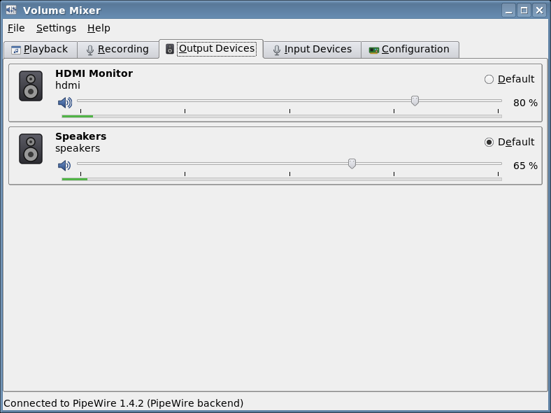 | 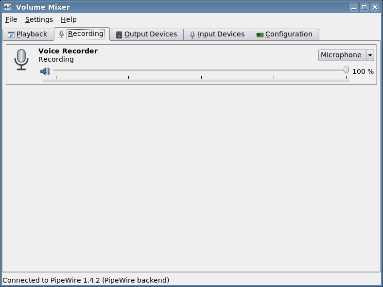 |
| 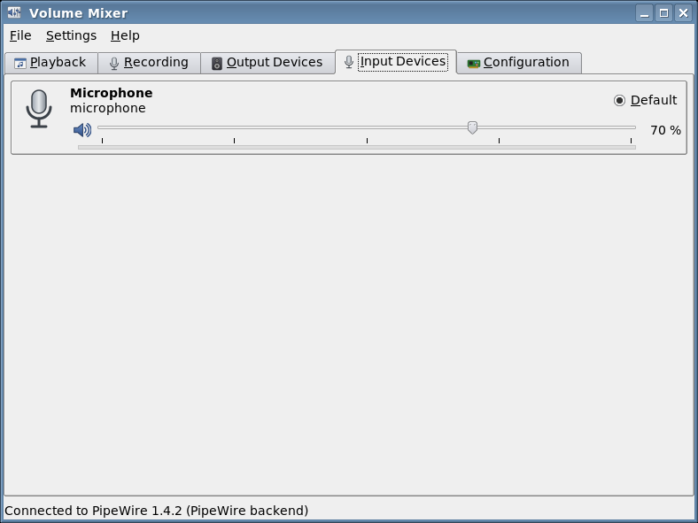 | 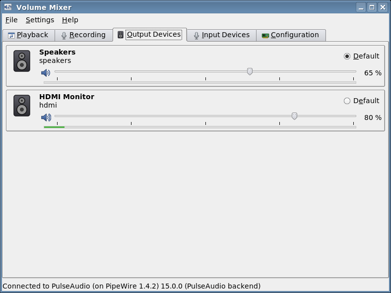 |
| 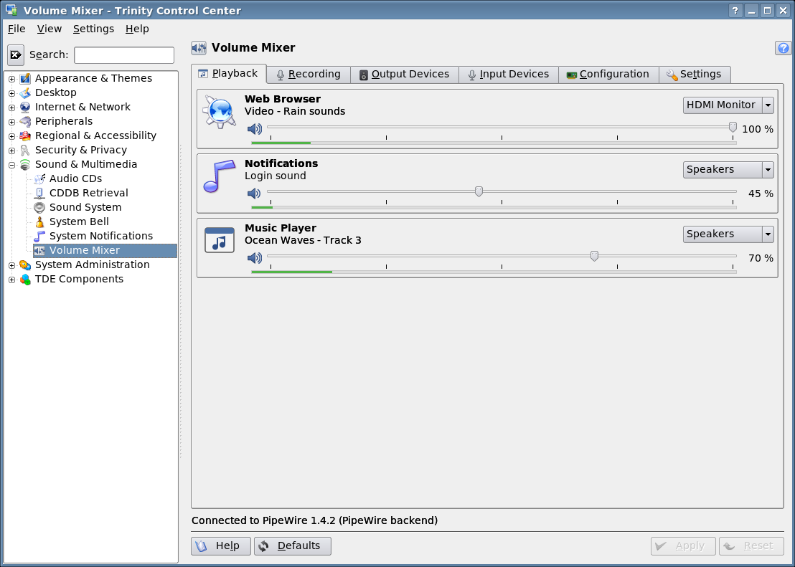 | 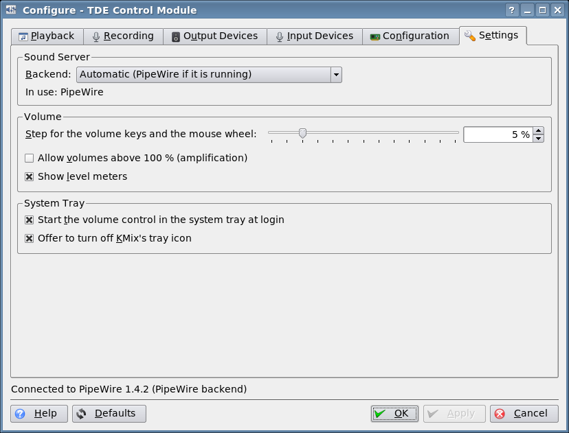 |
| 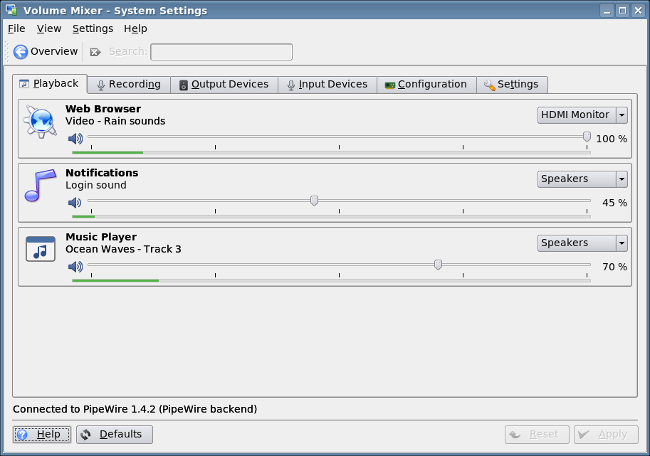 | 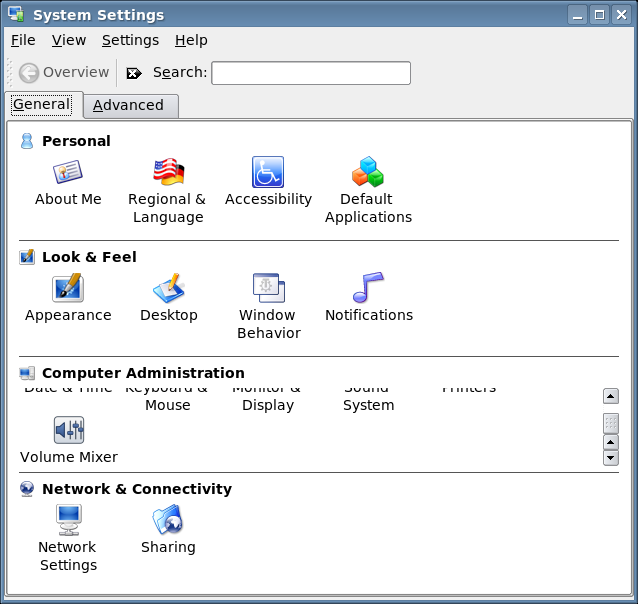 |
| 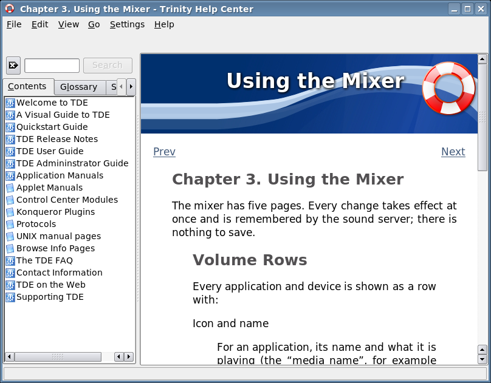 | 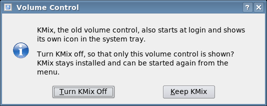 |
| 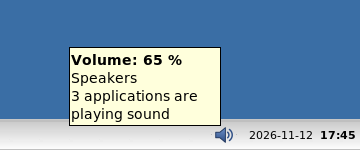 | |

The screenshots were taken with `tools/take-screenshots.sh` in a Debian
trixie container with PipeWire 1.4 and virtual devices.

## License

GPL-2.0-or-later; the handbook is also available under the GFDL 1.2.
